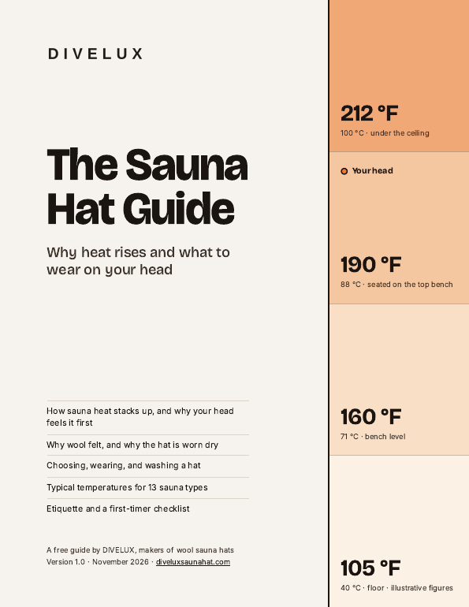

# The Sauna Hat Guide

**Why heat rises and what to wear on your head.** A free 12-page guide from [DIVELUX](https://diveluxsaunahat.com), makers of handmade wool felt sauna hats.

- [guide.pdf](guide.pdf) — the guide, US Letter, 12 pages
- [slides.pdf](slides.pdf) — the same material as 13 slides (16:9)
- `guide.html`, `slides.html`, `build.py` — sources

## What is inside

1. The short version
2. Why the air is hottest at the top of a hot room
3. What a sauna hat does, and what it does not do
4. Hats and head wraps by tradition
5. Why wool felt, and how linen, cotton and synthetic felt compare
6. How to choose a hat (a loose fit is a plus)
7. How to wear it (dry) and care for it (hand wash in cool, room-temperature water; never a machine or dryer)
8. Typical temperatures by sauna type
9. Sauna etiquette in brief
10. A one-page checklist for first-timers

The temperature table comes from our open dataset, [Sauna Traditions of the World](https://github.com/divelux/sauna-traditions-dataset). To plan a session, try the free [Sauna Session Planner](https://divelux.github.io/sauna-session-planner/).

This guide is general information, not medical advice.

## Cite

DIVELUX (2026). *The Sauna Hat Guide: Why Heat Rises and What to Wear on Your Head* (1.0). Zenodo. https://doi.org/10.5281/zenodo.24382674

## License

Text and diagrams: [CC BY 4.0](https://creativecommons.org/licenses/by/4.0/). Share and adapt with credit to DIVELUX and a link to https://diveluxsaunahat.com. Product photographs and the DIVELUX name and logo are © DIVELUX Inc.

More free sauna tools: https://diveluxsaunahat.com/pages/sauna-tools
